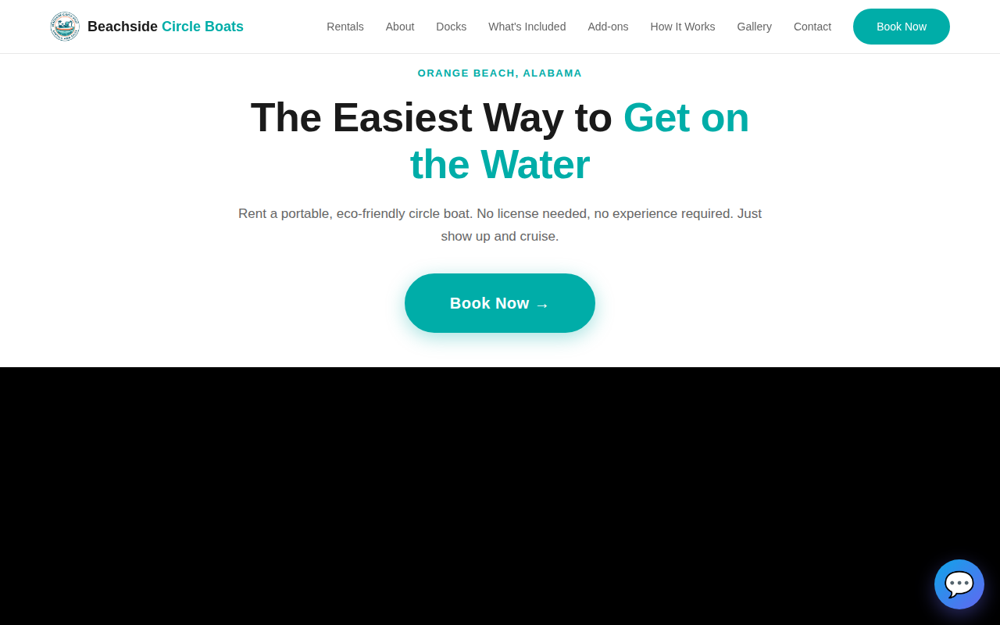
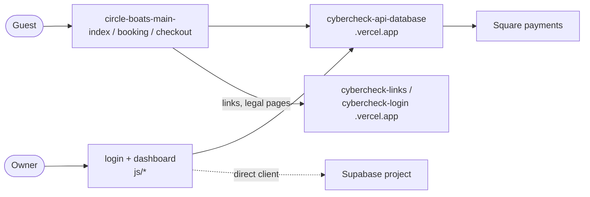

# circle-boats-main-

Website and owner dashboard for Beachside Circle Boats, an electric circle-boat rental in Orange Beach, Alabama.

## What it is

A static site with three parts: a public marketing page with booking and checkout, small customer pages (confirmation, review, waiver form, link-in-bio), and a large owner back office for bookings, calendar, customers, marketing, menus and site editing. It is a real customer's site. Live data, availability and payments all come from external services; this repo is only the front end.



The screenshot was taken offline, so the hero video area shows black.

## How it works

- No build step and no `package.json`. `vercel.json` serves the repo root as-is, turns on clean URLs, and rewrites `/login` and `/dashboard` to `login.html` and `dashboard.html`.
- Public pages: `index.html` (main page), `booking.html` (picks a slot and places a hold via `/api/public/hold`), `checkout.html` (payment config, waiver, then `/api/square/create-payment`), `confirmation.html`, `review.html`, `waiver-form.html`, `links.html`, `privacy.html`, `terms.html`, `404.html`. `index-no-video.html` and `index-v1-backup.html` are older variants.
- `tracking.js`: page-view and conversion tracking; sends events tagged with the subdomain `beachside-circle-boats`.
- `config.js`: multi-tenant config; maps the subdomain `beachside-circle-boats` to a business id and loads the business profile.
- Owner side: `login.html` and `dashboard.html` load about 90 scripts from `js/` (bookings, calendar, customers, coupons, waivers, inventory, SMS automations, voice notes, page builder, site editor, billing, menu manager, AI assistant, admin views, and more). `js/module-loader.js` and `js/module-registry.js` wire the modules; `js/api-client.js` is a small fetch wrapper whose default base is a local backend.
- Most calls go to `https://cybercheck-api-database.vercel.app` (`/api/public/...`, `/api/dashboard/...`, `/api/auth/...`). Some dashboard scripts also use a Supabase client directly.
- Checkout text says "Stripe", but the payment call in `checkout.html` goes to a Square endpoint on the API.
- `css/`, `images/`, `uploads/` hold styles and media.

## Run it

No install and no required environment variables. Serve the folder with any static server:

```bash
python3 -m http.server 8000   # then open http://localhost:8000/index.html
```

Pages render locally, but availability, booking, checkout, login and the dashboard need the external API (and the Supabase project the dashboard uses) to be reachable. Behind `localhost`, `booking.html` and `tracking.js` point at local backends that are not part of this repo.

## Status

In use: a live customer's site plus back office, last committed May 2026; it depends entirely on external services that were not checked for liveness.

## Where it fits



## Related repos

- cybercheck-api-database: the API host used for profile, fleet, bookings, hold, waivers and tracking.
- cybercheck-links- and cybercheck-login: host the shared link pages and legal pages this site links to.
- gar-profiles-: holds the same business as a data file (`data/beachside-circle-boats.js`).
- cybercheck-saas and trip-swipe-live: use the same API host.
- Admin-dashboard-main and Dashboards-users-: other dashboard repos in the estate; not compared.
